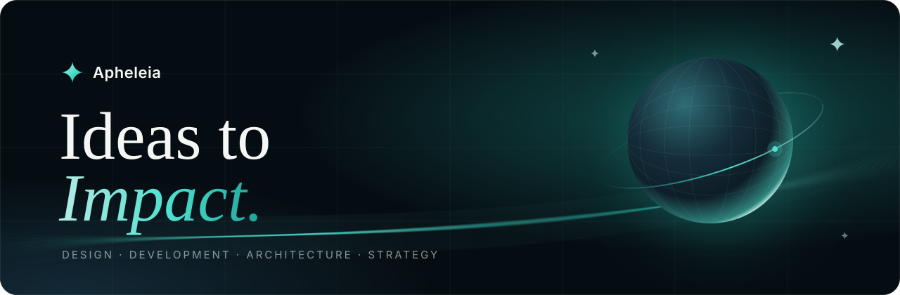

<p align="center">
  <a href="https://apheleiateam.vercel.app">
    
  </a>
</p>

<h3 align="center">Simplicity, built for scale.</h3>

<p align="center">
  Apheleia designs and builds digital products that feel effortless —<br>
  simple on the surface, engineered to scale underneath.
</p>

<p align="center">
  <a href="https://apheleiateam.vercel.app"></a>
  <a href="mailto:hello@apheleia.com"></a>
  
  
</p>

<p align="center">
  <a href="#about">About</a> ·
  <a href="#what-we-do">What we do</a> ·
  <a href="#how-we-work">How we work</a> ·
  <a href="#our-principles">Principles</a> ·
  <a href="#selected-work">Work</a> ·
  <a href="#the-website">The website</a> ·
  <a href="#get-in-touch">Contact</a>
</p>

<br>

## About

**Apheleia** — *ἀφέλεια* — is the Greek spirit of simplicity.

We're a creative studio for what's next: seven friends from Tamil Nadu, India — designers, engineers and strategists — building digital products that feel effortless, and the systems that keep them that way at scale.

<table>
  <tr>
    <td align="center" width="33%"><h1>07</h1>Co-founders, one mission</td>
    <td align="center" width="33%"><h1>04</h1>Core disciplines</td>
    <td align="center" width="33%"><h1>2026</h1>Founded in Tamil Nadu</td>
  </tr>
</table>

## What we do

End-to-end solutions for your digital journey — from strategy to scale.

| | Service | What it means |
|:-:|---|---|
| ✦ | **UI/UX Design** | Intuitive interfaces and design systems that make complex things feel simple. |
| ✦ | **Web & App Development** | Fast, scalable and secure products built on modern stacks. |
| ✦ | **System Architecture** | Resilient backends, clean APIs and infrastructure that grows with you. |
| ✦ | **Brand & Strategy** | Positioning, voice and identity grounded in purpose. |

## How we work

A simple process. A powerful outcome. From first conversation to launch, we keep things clear and seamless.

| 01 · Discover | 02 · Design | 03 · Develop | 04 · Launch |
|---|---|---|---|
| Understand your goals, users and constraints. | Shape intuitive, beautiful solutions. | Build with precision and scale in mind. | Go live, measure, and keep improving. |

## Our principles

Simple by design. Built to last. The ideas we hold ourselves to on every project, big or small.

> **01 — Design for ease**
> *Simplicity isn't the absence of features. It's the absence of friction.*

> **02 — Engineer for scale**
> *We build systems that are calm to operate and a delight to use.*

> **03 — Ship with purpose**
> *Every pixel and every endpoint has to earn its place.*

## Selected work

Ideas we've brought to life.

| Project | Type |
|---|---|
| **Kurinji** | Mobile app · Digital product |
| **Grounding Engine** | Platform · System architecture |
| **Your idea** | Next up — [let's build it](mailto:hello@apheleia.com?subject=Project%20enquiry) |

<br>

---

## The website

This repository is the source for **[apheleiateam.vercel.app](https://apheleiateam.vercel.app)** — a single-page site built with React and Vite. No component library and no CSS framework: the hero ribbon and the process story are real-time 3D (three.js), the other illustrations are hand-written inline SVG, and all styling is plain CSS driven by design tokens.

### Tech stack

| Layer | Choice |
|---|---|
| UI | [React 18](https://react.dev) |
| Build tool | [Vite 5](https://vitejs.dev) with `@vitejs/plugin-react` |
| 3D | [three.js](https://threejs.org) via [React Three Fiber](https://r3f.docs.pmnd.rs) — lazy-loaded into its own chunk |
| Styling | Plain CSS — one stylesheet per component, tokens in `src/index.css` |
| Type | [Quicksand](https://fonts.google.com/specimen/Quicksand) (display, stand-in for Davigo Pro) + [Inter](https://fonts.google.com/specimen/Inter) (text), via Google Fonts |
| Hosting | [Vercel](https://vercel.com) |

### Quick start

You'll need **Node.js 18+**.

```bash
git clone https://github.com/apheleiateam/apheleiateam.git
cd apheleiateam
npm install
npm run dev        # dev server at http://localhost:5173
```

| Command | What it does |
|---|---|
| `npm run dev` | Start the Vite dev server with hot reload |
| `npm run build` | Build the production site into `dist/` |
| `npm run preview` | Serve the production build locally to check it |

### Project structure

```text
.
├── index.html              # HTML shell: meta, fonts, favicon, pre-paint theme script (?theme=)
├── public/
│   └── favicon.svg         # Sparkle mark
└── src/
    ├── main.jsx            # Entry point
    ├── theme.jsx           # Light/dark theme provider + toggle state
    ├── App.jsx             # Page layout and the shared contact-dialog state
    ├── content.js          # Email, nav links, social links, enquiry topics
    ├── brand/logo.js       # The Apheleia "A" mark as vector paths (used everywhere)
    ├── index.css           # Design tokens, base styles, shared utilities
    ├── hooks/
    │   ├── interactions.js # 3D tilt + glare for cards, magnetic buttons
    │   ├── useReveal.js    # Fades sections in as they scroll into view
    │   └── useScrollSpy.js # Highlights the nav link for the current section
    ├── three/              # WebGL scenes (loaded only when needed)
    │   ├── strands.js       # Energy-flow strands (shaders): light sheets, fibres, dust, cursor
    │   ├── particles.js     # Particle universe: logo → helix → wave → vortex → ring, + starfield
    │   ├── bloom.js         # HDR bloom chain used by the strands and particles
    │   ├── StrandsBackground.jsx # Fixed page background; strand pose morphs per section
    │   ├── RibbonCanvas.jsx # Hero: glass card ribbon refracting the strands
    │   ├── StoryCanvas.jsx  # Process: liquid → board → cards land → launch
    │   ├── palette.js       # 3D colours for light and dark
    │   ├── textures.js      # Canvas-drawn board and card UI textures
    │   ├── Env.jsx          # Procedural studio reflections
    │   └── utils.js         # Easing, seeded random, in-view / reduced-motion hooks
    └── components/         # One .jsx + .css pair per section
        ├── Nav             # Fixed glass nav, scroll-spy, theme toggle, mobile menu
        ├── Hero            # "Ideas to Impact." over the 3D card ribbon
        ├── Story           # Pinned, scroll-driven 3D process (Discover → Launch)
        ├── Team            # 3D ring of team portraits (lime duotone), drag / click / auto-advance
        ├── ThemeSwitch     # Liquid-glass light/dark switch (magnifying lens)
        ├── Marquee         # Two crossing bands that speed up with scroll
        ├── Words.jsx       # Word-by-word heading reveal
        ├── CountUp.jsx     # Stats that count up on first view
        ├── About           # Story, arch illustration and stats
        ├── Services        # Four service cards with pointer-following glow
        ├── Work            # Horizontally scrolling project carousel
        ├── Principles      # Rotating principle quotes and toolkit
        ├── CTA             # "Ready to create something extraordinary?"
        ├── Footer
        ├── ContactDialog   # "Start a project" modal
        ├── Silk.jsx        # The flowing silk-ribbon motif
        └── Icons.jsx       # Inline SVG icon set
```

### Editing content

Most copy lives right next to the component that renders it, in a constant at the top of the file:

| To change… | Edit |
|---|---|
| Contact email, nav links, social links, enquiry topics | `src/content.js` |
| Service cards | `SERVICES` in `src/components/Services.jsx` |
| Projects in the carousel | `PROJECTS` in `src/components/Work.jsx` |
| Process steps | `STAGES` in `src/components/Story.jsx` |
| 3D scene colours | `src/three/palette.js` |
| Light-strand pose per section | `STRAND_SHAPES` in `src/three/strands.js` |
| Which particle shape sits where | `PARTICLE_SECTIONS` in `src/three/StrandsBackground.jsx` |
| Logo artwork | `src/brand/logo.js` (component: `src/components/Logo.jsx`) |
| Team members | add a photo `public/team/name_email.jpeg`, then list it in `TEAM_FILES` in `src/content.js` |
| Marquee words | `LIME` / `GLASS` in `src/components/Marquee.jsx` |
| Principle quotes and toolkit | `PRINCIPLES` and `TOOLKIT` in `src/components/Principles.jsx` |
| About-section stats | `STATS` in `src/components/About.jsx` |
| Page title and meta description | `inde### Brand & theming

**Palette — "Eternal flame"**: a green flame burning on a marble column in the dark. The site ships a **dark** theme (night + flame) and a **light** theme (marble), follows the visitor's OS setting until they use the sun/moon toggle in the nav, and remembers the choice. Everything is **glassmorphic**: frosted panels (`.glass`) float over a living background of **light strands** — hundreds of glowing fibres that converge in a hot focal point, ripple, shed dust, bend around the cursor, and change pose from section to section as you scroll. The 3D ribbon, board, cubes and task cards are real refractive glass bending that light.

| | Colour | Hex | Use |
|:-:|---|---|---|
|  | Night | `#030503` | Dark background |
|  | Flame | `#46D35B` | Primary accent, buttons |
|  | Logo lime | `#BCFA03` | The mark, highlights, glows |
|  | White-hot core | `#E2F7B8` | Gradient cores |
|  | Bowl green | `#239447` | Deep accent |
|  | Celadon marble | `#AECBAA` | Secondary surfaces |
|  | Marble white | `#EEF2EC` | Light background |
|  | Deep forest | `#0C1F12` | Light-theme text |

All colours are CSS custom properties at the top of `src/index.css` (dark is the base, `[data-theme='light']` overrides it). The WebGL scenes take theirs from `src/three/palette.js`, and the flame light field is a shader in `src/three/glow.js`.

**Preview a theme** without changing your saved choice by adding `?theme=light` or `?theme=dark` to the URL — for example [apheleiateam.vercel.app/?theme=light](https://apheleiateam.vercel.app/?theme=light).

**Typeface.** The display face we want is [Davigo Pro](https://fontesk.com/davigo-pro-font/) by Lettertype Studio, but it is listed as *free for personal use* — a company website needs a commercial licence or written permission from the designer. Until then the site uses **Quicksand** (SIL Open Font License), the closest free rounded geometric match. `--display` in `src/index.css` already lists `'Davigo Pro'` first, so once licensed:

1. Put the web font files in `public/fonts/` (e.g. `DavigoPro-Bold.woff2`).
2. Add an `@font-face` for `'Davigo Pro'` at the top of `src/index.css` pointing at them.

No other change is needed — every heading, button and nav item picks it up.

e=light).

### How the contact form works

"Start a Project", "Let's Talk", "Get in Touch" and the service cards' "Learn More" buttons all open the same contact dialog. The service buttons pre-select the matching interest (for example *System Architecture*).

There's no backend yet: submitting the form opens the visitor's email app with a pre-filled message to `hello@apheleia.com`. To change the address, edit `EMAIL` in `src/content.js`.

### Deployment

The site is hosted on Vercel, which detects Vite automatically — no config file is needed.

| Setting | Value |
|---|---|
| Framework preset | Vite |
| Build command | `npm run build` |
| Output directory | `dist` |

### Before launch

Placeholders still in the code, marked with `TODO` or "placeholder" comments:

- [ ] Add real LinkedIn, X and Instagram profile URLs — `SOCIALS` in `src/content.js` (currently `#`)
- [ ] Confirm the toolkit list matches the stack we actually use — `TOOLKIT` in `src/components/Principles.jsx`
- [ ] Swap the project illustrations for real screenshots — `src/components/Work.jsx`
- [ ] Replace the hero orb with the 3D render and the About arch with brand photography — `Hero.jsx`, `About.jsx`
- [ ] Connect the contact form to a backend or form service so enquiries don't depend on the visitor's email app

---

## Get in touch

**Ready to create something extraordinary?** Let's turn your ideas into impact.

✉️ **[hello@apheleia.com](mailto:hello@apheleia.com)** &nbsp;·&nbsp; 🌐 **[apheleiateam.vercel.app](https://apheleiateam.vercel.app)**

<br>

<p align="center">
  <br>
  <sub>© 2026 Apheleia. All rights reserved. · Made with care in Tamil Nadu, India.</sub>
</p>
