

<a href="https://apheleiateam.vercel.app"></a>


<a href="https://apheleiateam.vercel.app/#about"></a>

<a href="https://apheleiateam.vercel.app/#process"></a>

<a href="https://apheleiateam.vercel.app/#services"></a>


&nbsp;&nbsp;<a href="mailto:mehanth362@gmail.com"></a>&nbsp;

<a href="mailto:skpaveethiran@gmail.com"></a>&nbsp;&nbsp;<a href="mailto:ramcharanslm8@gmail.com"></a>

<a href="https://apheleiateam.vercel.app/#work"></a>

<a href="https://apheleiateam.vercel.app/#principles"></a>

<a href="mailto:apheleia.team@gmail.com?subject=Project%20enquiry"></a>

&nbsp;&nbsp;

<a href="https://apheleiateam.vercel.app"></a>

  <a href="https://apheleiateam.vercel.app"><b>apheleiateam.vercel.app</b></a>
  &nbsp;·&nbsp;
  <a href="mailto:apheleia.team@gmail.com"><b>apheleia.team@gmail.com</b></a>
  &nbsp;·&nbsp;
  <a href="https://www.instagram.com/apheleia.team/"><b>Instagram @apheleia.team</b></a>
  &nbsp;·&nbsp;
  <a href="#top">Back to top ↑</a>

